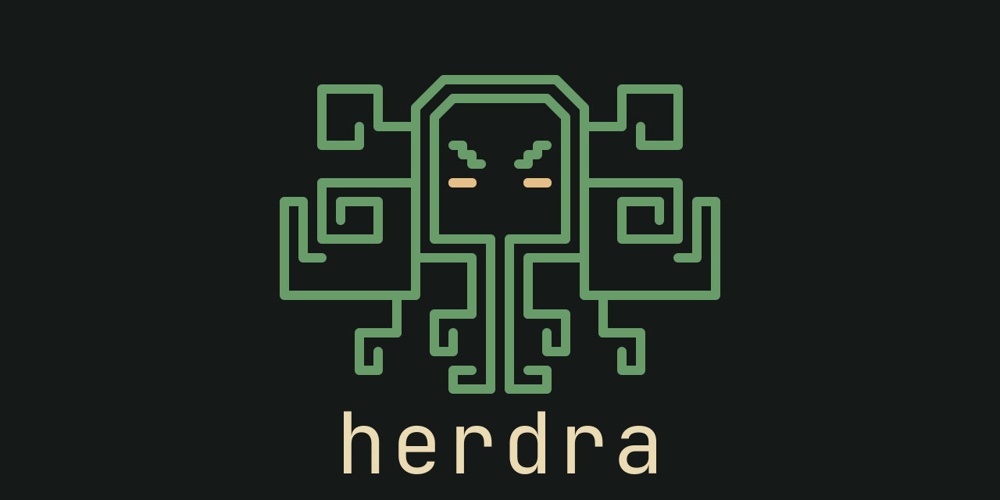
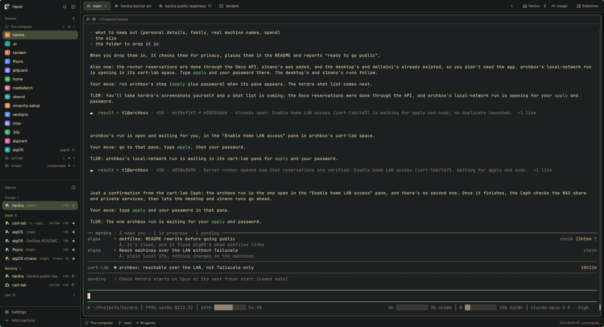
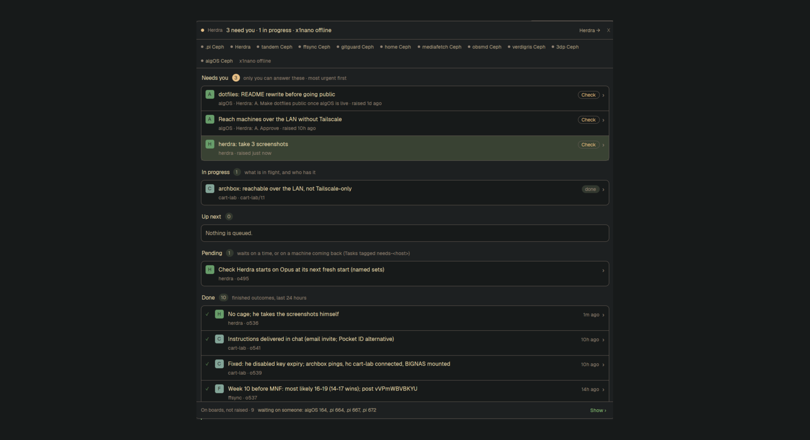

Herdra is an orchestrator: the one agent I talk to, directing a team of agents across all my projects and machines. This is my personal setup, shared as a reference; adapt the ideas rather than running it as-is.

## Showcase

<table>
  <tr>
    <td width="50%"></td>
    <td width="50%"></td>
  </tr>
  <tr>
    <td align="center">Herdra in herdr, with its open-items list</td>
    <td align="center">The Herdra window</td>
  </tr>
</table>

## Built on

- [pi](https://github.com/earendil-works/pi): the agent harness every role runs in; [my config](https://github.com/Algorant/pi) adds the inbox between agents and the tools that start them.
- [herdr](https://herdr.dev): the terminal workspace, one space per project and a tab per agent, with child agents nested under the agent that started them.
- [tandem](https://github.com/Algorant/tandem): a task board per project; a Task holds the scope, and agents claim and deliver it.

## The four roles

Four agents, each one level below the last: a request travels down until a Worker builds it, and results come back up one level at a time.

| Role | What it does | Its results go to |
| --- | --- | --- |
| **Herdra** | The agent I talk to: routes each request to the project that owns it, tracks what's open, does no project work itself. | me, as results, decisions and blockers only |
| **Ceph** | A project's lead agent in the main tab of its space: owns the board, splits work into tracks, runs them in parallel, reviews and merges what comes back. | Herdra, merged |
| **manus** | Another long-running tab in the project's space, carrying one track in its own worktree and sending out dendra for the pieces. | the Ceph |
| **dendra** | Short-lived children: a Worker that builds one Task in its own checkout, or a read-only scout, researcher or reviewer. | the manus that sent it, then it closes |

## Primitives

The building blocks the roles hand around, one line each:

- **Task** — one unit of work on a project's tandem board: the scope, what done means, and who owns it. Agents claim it, work it and deliver it.
- **Inbox message** — the durable hand-off between two agents, one headline line and the detail below it; the reply closes the request it answers.
- **Open item** — Herdra's line for anything it owes or waits on: who has the next move, and what ends it.
- **Worktree** — each track's own checkout of the repository, so tracks run in parallel without colliding.
- **Sideshow post** — the visual hand-off for a look or a decision: the artifact rendered as its reader will see it.
- **User-run script** — a step only I can take, handed over as one reviewed script (scriptify) that I start myself.
- **dendra kinds** — a read-only helper (scout, researcher or reviewer), or a Worker that builds one Task: each does one piece and closes.

## Capabilities

Small commands that do the unglamorous work of running the fleet:

- **`herdra-checkin`** — a factual card for an agent, a project or a Task: what it is doing, its branch and uncommitted work, its inbox, the items it owes, and one verdict.
- **`herdra-cutover`** — move every role onto another provider's quota at once, refusing when that provider is near its limit; `status` reads back who runs on what.
- **`herdra-tidy`** — lists what is safe to let go, heavy sessions and stale temp files, plus one line per agent tab saying keep, close or ask; `--close` closes the tabs it names.
- **`herdra-open`** — the open-items list behind every reply: what is waiting on someone, what I promised, and what needs me.
- **`herdra-revive`** — after a reboot, resume each agent's session, restart the boards and Sideshow.

## License

[MIT](LICENSE)
