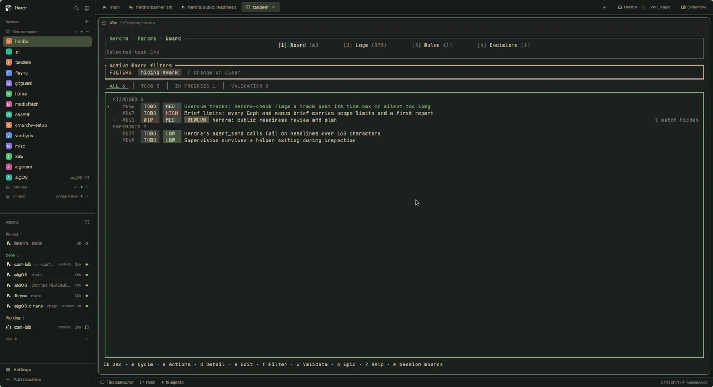
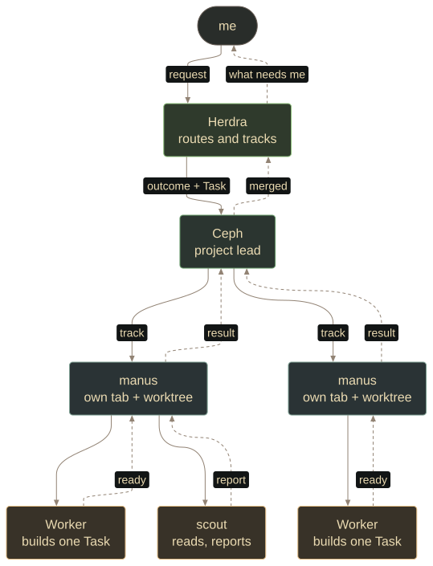

Herdra is an orchestrator: the one agent I talk to, directing a team of agents across all my projects and machines. This is my personal setup, shared as a reference; adapt the ideas rather than running it as-is.

## Showcase

<table>
  <tr>
    <td width="50%"></td>
    <td width="50%"></td>
  </tr>
  <tr>
    <td align="center">Herdra in herdr, with its open-items list</td>
    <td align="center">The Herdra window</td>
  </tr>
</table>

## Built on

- [pi](https://github.com/earendil-works/pi): the agent harness every role runs in; [my config](https://github.com/Algorant/pi) adds the inbox between agents and the tools that start them.
- [herdr](https://herdr.dev): the terminal workspace, one space per project and a tab per agent, with child agents nested under the agent that started them.
- [tandem](https://github.com/Algorant/tandem): a task board per project; a Task holds the scope, and agents claim and deliver it.

## The four roles

- **Herdra** is the agent I talk to. It routes each request to the project that owns it, keeps track of what's open, and brings back only results, decisions and blockers. It does no project work itself.
- **Ceph** is a project's lead agent, in the main tab of that project's space. It owns the project's board, splits the work into tracks, runs them in parallel, then reviews and merges what comes back.
- **manus** is another long-running tab in the project's space, carrying one track in its own worktree. It sends out dendra for the pieces and reports to the Ceph.
- **dendra** are short-lived children: a Worker that builds one Task in its own checkout, or a read-only scout, researcher or reviewer. Each does one piece, hands it back and closes.

## How the roles work together

## License

[MIT](LICENSE)
